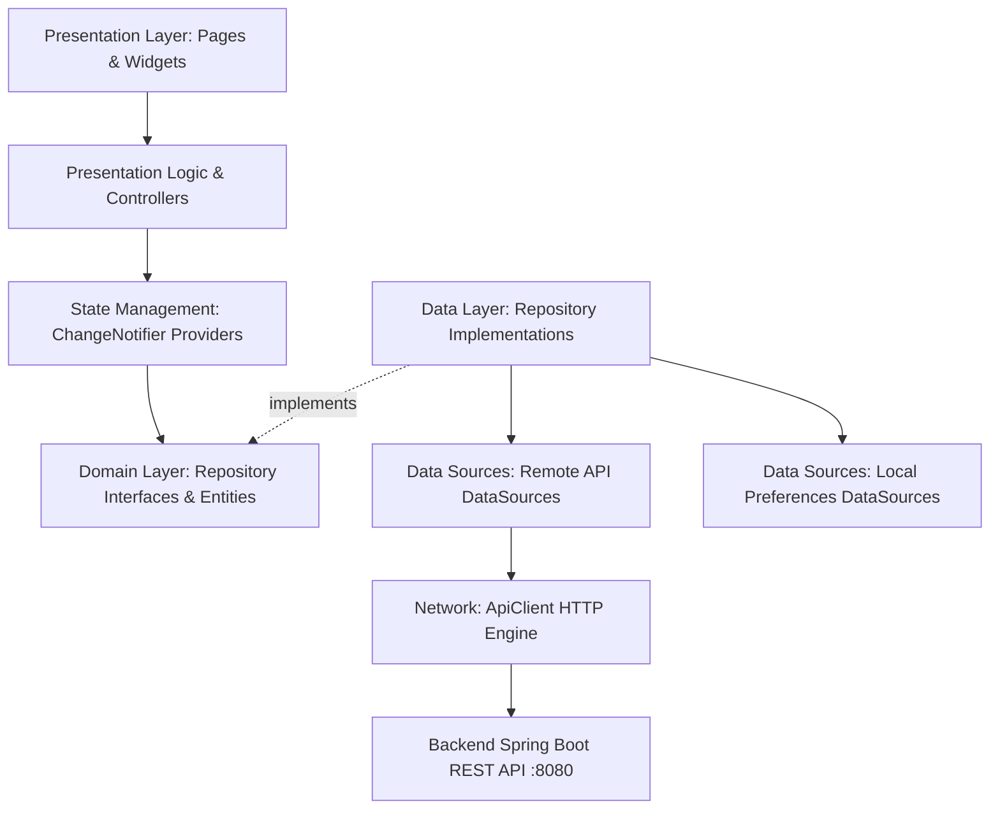

# KIẾN TRÚC FRONTEND VÀ HƯỚNG DẪN KẾT NỐI API BACKEND
> **Dự án:** Ứng dụng Bookstore Mobile (`code/bookstore`)  
> **Nền tảng:** Flutter (Dart 3+) + Provider State Management  
> **Kiến trúc:** Feature-First Clean Architecture tuân thủ nguyên lý SOLID  

---

## 1. TỔNG QUAN KIẾN TRÚC FRONTEND

Ứng dụng Flutter được xây dựng theo mô hình **Feature-First Clean Architecture**, phân tách độc lập giữa Tầng giao diện (Presentation), Tầng nghiệp vụ (Domain) và Tầng dữ liệu (Data).



### Các nguyên tắc thiết kế chính (SOLID):
1. **Single Responsibility (SRP)**: Mỗi class, datasource, provider và widget chỉ chịu một trách nhiệm duy nhất (ví dụ: `CheckoutLogic` quản lý validation và đặt hàng, `AddressLocalDataSource` quản lý sổ địa chỉ giao hàng).
2. **Open/Closed (OCP)**: Dễ dàng mở rộng thêm các bộ lọc hoặc tham số tìm kiếm thông qua các Value Objects như `BookFilterParams`, `PlaceOrderParams` mà không phải sửa đổi API client gốc.
3. **Liskov Substitution (LSP)**: Các Data Model (`BookModel`, `OrderModel`, `UserModel`) kế thừa trọn vẹn từ các Domain Entity (`Book`, `Order`, `User`), có thể thay thế nhau mà không làm hỏng logic.
4. **Interface Segregation (ISP)**: Định nghĩa interface Repository nhỏ gọn theo từng tính năng (`AuthRepository`, `BookRepository`, `CartRepository`, `OrderRepository`, `FavoriteRepository`).
5. **Dependency Inversion (DIP)**: Tầng Presentation và Domain chỉ phụ thuộc vào Repository Interface trừu tượng, không phụ thuộc vào `http.Client` hay `SharedPreferences`. Toàn bộ phụ thuộc cụ thể được khởi tạo tại **Composition Root** [AppDependencies](file:///d:/Project/PRM393/code/bookstore/lib/app/injection.dart).

---

## 2. BẢN ĐỒ CÁC FILE TRONG SOURCE CODE FRONTEND

```
lib/
├── app/                                    # Điểm cấu hình gốc của ứng dụng
│   ├── app.dart                            # MaterialApp, Theme, Cấu hình Router và AuthGate
│   └── injection.dart                      # Composition Root: Khởi tạo DI và tiêm Provider
│
├── core/                                   # Các thành phần dùng chung toàn ứng dụng
│   ├── error/
│   │   └── app_exception.dart              # Định nghĩa các ngoại lệ nghiệp vụ (AppException, UnauthorizedException)
│   ├── network/
│   │   ├── api_client.dart                 # HTTP Client wrapper: Đính kèm Bearer token, timeout, bắt lỗi 401
│   │   └── api_endpoints.dart              # Danh bạ toàn bộ URL endpoints tới Backend
│   ├── utils/
│   │   ├── currency_formatter.dart         # Định dạng tiền tệ VNĐ (ví dụ: "150.000 ₫")
│   │   ├── date_formatter.dart             # Định dạng ngày giờ hiển thị (HH:mm dd/MM/yyyy)
│   │   └── validators.dart                 # Hàm kiểm tra hợp lệ: bắt buộc, email, mật khẩu
│   └── widgets/
│       └── app_text_field.dart             # Ô nhập văn bản chuẩn hóa giao diện
│
├── features/                               # Phân chia theo từng tính năng nghiệp vụ
│   ├── auth/                               # Phân hệ Xác thực & Tài khoản
│   │   ├── data/
│   │   │   ├── datasources/
│   │   │   │   ├── auth_local_datasource.dart   # Lưu/đọc Token JWT và User vào SharedPreferences
│   │   │   │   └── auth_remote_datasource.dart  # Gọi API POST /api/auth/login, POST /api/auth/register
│   │   │   ├── models/
│   │   │   │   └── user_model.dart              # Map JSON người dùng (hỗ trợ cả username, role, email)
│   │   │   └── repositories/
│   │   │       └── auth_repository_impl.dart    # Hiện thực hóa nghiệp vụ đăng nhập, đăng ký, đăng xuất
│   │   ├── domain/
│   │   │   ├── entities/
│   │   │   │   ├── register_params.dart         # DTO đăng ký: username, email, password, fullName
│   │   │   │   └── user.dart                    # Entity thông tin người dùng
│   │   │   └── repositories/
│   │   │       └── auth_repository.dart         # Interface trừu tượng xác thực
│   │   └── presentation/
│   │       ├── logic/
│   │       │   ├── login_logic.dart             # Xử lý sự kiện đăng nhập, validate form
│   │       │   └── register_logic.dart          # Xử lý sự kiện đăng ký tài khoản
│   │       ├── pages/
│   │       │   ├── login_page.dart              # Màn hình Đăng nhập
│   │       │   └── register_page.dart           # Màn hình Đăng ký
│   │       └── providers/
│   │           └── auth_provider.dart           # Quản lý State phiên đăng nhập hiện tại
│   │
│   ├── books/                              # Phân hệ Sách & Danh mục
│   │   ├── data/
│   │   │   ├── datasources/
│   │   │   │   └── book_remote_datasource.dart  # Gọi GET /api/books (có query filter), POST/PUT/DELETE
│   │   │   ├── models/
│   │   │   │   └── book_model.dart              # Parse JSON: hỗ trợ cả camelCase lẫn lowercase, parse status enum
│   │   │   └── repositories/
│   │   │       └── book_repository_impl.dart    # Cầu nối lấy dữ liệu sách
│   │   ├── domain/
│   │   │   ├── entities/
│   │   │   │   ├── book.dart                    # Entity Sách (12 thuộc tính: isbn, categoryId, stockQuantity,...)
│   │   │   │   ├── book_filter_params.dart      # Bộ lọc tìm kiếm động (keyword, isbn, categoryId, khoảng giá, tồn kho)
│   │   │   │   └── create_book_params.dart      # Tham số tạo/sửa sách
│   │   │   └── repositories/
│   │   │       └── book_repository.dart         # Interface quản lý sách
│   │   └── presentation/
│   │       ├── logic/
│   │       │   ├── book_detail_logic.dart       # Xử lý thêm vào giỏ hàng, toggle yêu thích từ trang chi tiết
│   │       │   └── book_list_logic.dart         # Xử lý debounce tìm kiếm, mở sheet lọc
│   │       ├── pages/
│   │       │   ├── add_book_page.dart           # Màn hình Thêm sách mới (dành cho Staff/Admin)
│   │       │   ├── book_detail_page.dart        # Màn hình Chi tiết một cuốn sách
│   │       │   └── book_list_page.dart          # Màn hình Trang chủ: Danh sách sách, thanh tìm kiếm, tag lọc
│   │       ├── providers/
│   │       │   ├── add_book_controller.dart     # Quản lý form nhập liệu tạo sách
│   │       │   └── book_provider.dart           # Quản lý danh sách sách, trạng thái loading/lỗi, thực hiện lọc
│   │       └── widgets/
│   │           ├── book_card.dart               # Thẻ hiển thị một cuốn sách trên danh sách
│   │           ├── book_filter_sheet.dart       # Modal bottom sheet bộ lọc nâng cao (giá, tồn kho, trạng thái)
│   │           ├── book_status_card.dart        # Thẻ trạng thái còn hàng / hết hàng
│   │           └── book_text_field.dart         # Widget nhập liệu form sách
│   │
│   ├── cart/                               # Phân hệ Giỏ hàng
│   │   ├── data/
│   │   │   ├── datasources/
│   │   │   │   └── cart_local_datasource.dart   # Lưu trữ giỏ hàng riêng theo từng user vào SharedPreferences
│   │   │   ├── models/
│   │   │   │   └── cart_item_model.dart         # Parse JSON giỏ hàng offline
│   │   │   └── repositories/
│   │   │       └── cart_repository_impl.dart    # Cập nhật thêm/bớt/xóa giỏ hàng
│   │   ├── domain/
│   │   │   ├── entities/
│   │   │   │   ├── cart.dart                    # Entity tổng thể giỏ hàng (tính tổng tiền, tổng số lượng)
│   │   │   │   └── cart_item.dart               # Một dòng sách trong giỏ (bookId, bookName, price, quantity)
│   │   │   └── repositories/
│   │   │       └── cart_repository.dart         # Interface giỏ hàng
│   │   └── presentation/
│   │       ├── logic/
│   │       │   └── cart_logic.dart              # Xử lý tăng/giảm số lượng, điều hướng sang checkout
│   │       ├── pages/
│   │       │   └── cart_page.dart               # Màn hình Xem giỏ hàng
│   │       ├── providers/
│   │       │   └── cart_provider.dart           # Quản lý State giỏ hàng hiện tại
│   │       └── widgets/
│   │           └── cart_item_tile.dart          # Item một cuốn sách trong giỏ hàng
│   │
│   ├── favorites/                          # Phân hệ Sách Yêu thích
│   │   ├── data/
│   │   │   ├── datasources/
│   │   │   │   └── favorite_prefs_datasource.dart # Lưu danh sách bookId yêu thích theo user vào SharedPreferences
│   │   │   └── repositories/
│   │   │       └── favorite_repository_impl.dart  # Thao tác toggle yêu thích
│   │   ├── domain/
│   │   │   └── repositories/
│   │   │       └── favorite_repository.dart       # Interface yêu thích
│   │   └── presentation/
│   │       ├── logic/
│   │       │   └── favorite_logic.dart            # Logic xóa khỏi danh sách yêu thích
│   │       ├── pages/
│   │       │   └── favorite_page.dart             # Màn hình Danh sách sách yêu thích
│   │       └── providers/
│   │           └── favorite_provider.dart         # Quản lý State các bookId yêu thích
│   │
│   └── orders/                             # Phân hệ Quản lý Đơn hàng & Thanh toán
│       ├── data/
│       │   ├── datasources/
│       │   │   ├── address_local_datasource.dart  # Sổ địa chỉ giao hàng offline của người dùng
│       │   │   └── order_remote_datasource.dart   # Gọi API: POST /api/orders, GET /my-orders, duyệt, hủy,...
│       │   ├── models/
│       │   │   ├── order_item_model.dart          # Map JSON chi tiết mặt hàng: unitPrice, bookId
│       │   │   └── order_model.dart               # Map JSON đơn hàng: orderId, totalAmount, shippingAddress,...
│       │   └── repositories/
│       │       └── order_repository_impl.dart     # Cầu nối gọi đơn hàng & hợp nhất thông tin items
│       ├── domain/
│       │   ├── entities/
│       │   │   ├── order.dart                     # Entity Đơn hàng (mã, trạng thái, người duyệt, tổng tiền)
│       │   │   ├── order_item.dart                # Entity Mặt hàng trong đơn
│       │   │   ├── place_order_params.dart        # Tham số khi đặt hàng (items, người nhận, sđt, địa chỉ, ghi chú)
│       │   │   └── shipping_address.dart          # Entity thông tin địa chỉ giao hàng
│       │   └── repositories/
│       │       └── order_repository.dart          # Interface đơn hàng (đặt, hủy, duyệt, lấy đơn của tôi,...)
│       └── presentation/
│           ├── logic/
│           │   ├── admin_order_list_logic.dart    # Logic lọc đơn cho quản trị viên theo trạng thái
│           │   ├── checkout_logic.dart            # Quản lý chọn địa chỉ, validate số điện thoại VN, gửi đặt hàng
│           │   ├── order_action_logic.dart        # Xử lý hộp thoại hủy đơn, duyệt đơn, giao hàng
│           │   ├── order_detail_logic.dart        # Tải chi tiết đơn và các mặt hàng
│           │   └── order_list_logic.dart          # Kéo để làm mới (pull-to-refresh) danh sách đơn hàng
│           ├── pages/
│           │   ├── admin_order_list_page.dart     # Màn hình Quản trị Đơn hàng (Dành cho Staff/Admin)
│           │   ├── checkout_page.dart             # Màn hình Xác nhận Đặt hàng (chọn địa chỉ, sđt, tóm tắt)
│           │   ├── order_detail_page.dart         # Màn hình Xem chi tiết tiến độ đơn hàng
│           │   └── order_list_page.dart           # Màn hình Đơn hàng của tôi (Khách hàng)
│           ├── providers/
│           │   └── order_provider.dart            # Quản lý State danh sách đơn, trạng thái đang đặt hàng
│           └── widgets/
│               ├── address_form_dialog.dart       # Hộp thoại nhập địa chỉ mới
│               ├── address_selector_sheet.dart    # Bottom sheet chọn địa chỉ từ sổ địa chỉ đã lưu
│               ├── cancel_order_dialog.dart       # Hộp thoại nhập lý do hủy đơn
│               ├── order_status_badge.dart        # Huy hiệu màu sắc hiển thị trạng thái đơn (PENDING, APPROVED,...)
│               └── order_tile.dart                # Thẻ hiển thị một đơn hàng trên danh sách
│
└── main.dart                               # Entrypoint: Khởi tạo async DI và khởi chạy runApp()
```

---

## 3. CÁCH KẾT NỐI VÀ GIAO TIẾP VỚI BACKEND

### 3.1. Cấu hình Địa chỉ Máy chủ (Base URL)
Cấu hình tại [lib/core/network/api_endpoints.dart](file:///d:/Project/PRM393/code/bookstore/lib/core/network/api_endpoints.dart):

```dart
class ApiEndpoints {
  // Thay đổi baseUrl tùy theo môi trường chạy của bạn:
  // 1. Android Emulator: máy ảo Android dùng IP 10.0.2.2 để gọi về máy tính host:
  // static const baseUrl = 'http://10.0.2.2:8080';
  //
  // 2. iOS Simulator / Web / Windows App:
  static const baseUrl = 'http://localhost:8080';
  //
  // 3. Thiết bị di động thật (Real Phone qua Wi-Fi chung LAN):
  // static const baseUrl = 'http://192.168.1.x:8080';
  ...
}
```

### 3.2. Quản lý Token Xác thực & Đính kèm Tự động
Cơ chế được điều phối bởi [lib/core/network/api_client.dart](file:///d:/Project/PRM393/code/bookstore/lib/core/network/api_client.dart):
1. **Đăng nhập thành công**: [AuthRemoteDataSource](file:///d:/Project/PRM393/code/bookstore/lib/features/auth/data/datasources/auth_remote_datasource.dart) trích xuất chuỗi `accessToken` từ phản hồi của backend:
   ```dart
   final token = (json['accessToken'] ?? json['token']).toString();
   ```
2. **Lưu Token**: [AuthLocalDataSource](file:///d:/Project/PRM393/code/bookstore/lib/features/auth/data/datasources/auth_local_datasource.dart) lưu token vào `SharedPreferences`.
3. **Đính kèm tự động**: Trong mọi request tiếp theo, `ApiClient` gọi hàm `readToken()`. Nếu tồn tại token, tự động thêm Header:
   ```http
   Authorization: Bearer <accessToken>
   Content-Type: application/json
   Accept: application/json
   ```
4. **Tự động xử lý hết hạn (401 Unauthorized)**: Nếu backend trả về mã `401` khi request đã gửi kèm token (nghĩa là JWT đã hết hạn hoặc không hợp lệ):
   ```dart
   if (response.statusCode == 401 && hadToken) {
     _onUnauthorized?.call(); // Tự động kích hoạt authProvider.logout()
     throw const UnauthorizedException();
   }
   ```
   Ứng dụng sẽ tự động xóa token và chuyển màn hình về `LoginPage` thông qua `_AuthGate` trong [lib/app/app.dart](file:///d:/Project/PRM393/code/bookstore/lib/app/app.dart).

---

## 4. MA TRẬN KẾT NỐI API CHI TIẾT (FRONTEND $\rightarrow$ BACKEND)

| Thao tác UI trên App | Luồng gọi code Frontend | Endpoint Backend được gọi | Dữ liệu gửi đi (Request) | Dữ liệu phản hồi & Xử lý (Response) |
| :--- | :--- | :--- | :--- | :--- |
| **Đăng nhập** | `LoginPage` $\rightarrow$ `LoginLogic` $\rightarrow$ `AuthProvider.login()` $\rightarrow$ `AuthRemoteDataSource.login()` | `POST /api/auth/login` | `{"username": "...", "password": "..."}` | Nhận `accessToken`, lưu vào Preferences; chuyển về Trang chủ. |
| **Đăng ký** | `RegisterPage` $\rightarrow$ `RegisterLogic` $\rightarrow$ `AuthProvider.register()` $\rightarrow$ `AuthRemoteDataSource.register()` | `POST /api/auth/register` | `RegisterParams.toJson()`: `username`, `email`, `password`, `fullName` | Nhận HTTP 201; tự động chuyển sang đăng nhập. |
| **Tải danh sách sách** | `BookListPage` $\rightarrow$ `BookProvider.loadBooks()` $\rightarrow$ `BookRemoteDataSource.fetchBooks()` | `GET /api/books` | Không có | Parse mảng `BookModel` (nhận `bookId`, `bookName`, `price`, `stockQuantity`, `status`). |
| **Tìm kiếm & Lọc sách** | `BookFilterSheet` $\rightarrow$ `BookProvider.applyFilters(params)` $\rightarrow$ `fetchBooks(params)` | `GET /api/books?...` | Query params: `?keyword=...&minPrice=...&maxPrice=...&status=...` | Cập nhật lại danh sách sách đã lọc trên giao diện. |
| **Tạo sách mới (Admin)** | `AddBookPage` $\rightarrow$ `AddBookController.submit()` $\rightarrow$ `BookRemoteDataSource.createBook()` | `POST /api/books` | Header Bearer (Role STAFF/ADMIN) + `CreateBookParams.toJson()`: `isbn`, `bookName`, `author`, `publisher`, `categoryId`, `price`, `stockQuantity`,... | Nhận `BookModel` vừa tạo; tự động thêm vào đầu danh sách sách. |
| **Đặt hàng** | `CheckoutPage` $\rightarrow$ `CheckoutLogic` $\rightarrow$ `OrderProvider.placeOrder()` $\rightarrow$ `OrderRemoteDataSource.placeOrder()` | `POST /api/orders` | Header Bearer + `PlaceOrderParams`: `status: "PENDING"`, `shippingAddress`, `phone`, `receiverName`, `note`, `items: [{"bookid": ..., "quantity": ...}]` | Backend kiểm tra kho, tính tiền từ DB, lưu đơn; Client xóa giỏ hàng và mở thông báo thành công. |
| **Xem đơn của tôi** | `OrderListPage` $\rightarrow$ `OrderProvider.loadOrders()` $\rightarrow$ `OrderRemoteDataSource.fetchOrders()` | `GET /api/orders/my-orders` | Header Bearer | Parse danh sách `OrderModel` (chỉ đơn của user đang đăng nhập). |
| **Xem chi tiết đơn** | `OrderDetailPage` $\rightarrow$ `OrderDetailLogic` $\rightarrow$ `fetchOrder()` & `fetchOrderItems()` | `GET /api/orders/{id}` và `GET /api/orders/{id}/items` | Header Bearer | Hợp nhất thông tin đơn hàng và danh sách từng cuốn sách trong đơn. |
| **Khách hủy đơn** | `CancelOrderDialog` $\rightarrow$ `OrderActionLogic.cancelOrder()` $\rightarrow$ `OrderRemoteDataSource.cancelOrder()` | `POST /api/orders/{id}/cancel` | Header Bearer + `{"reason": "..."}` | Backend đổi `CANCELLED`, tự động cộng hoàn lại kho nếu đơn đã duyệt; App cập nhật lại trạng thái. |
| **Duyệt đơn (Admin)** | `AdminOrderListPage` $\rightarrow$ `OrderActionLogic.approveOrder()` | `POST /api/orders/{id}/approve` | Header Bearer (Role STAFF/ADMIN) | Backend đổi `APPROVED`, trừ tồn kho; App hiển thị badge Đã duyệt. |
| **Giao hàng (Admin)** | `AdminOrderListPage` $\rightarrow$ `OrderActionLogic.shipOrder()` | `POST /api/orders/{id}/ship` | Header Bearer (Role STAFF/ADMIN) | Đổi sang `SHIPPING`. |
| **Hoàn thành đơn** | `AdminOrderListPage` $\rightarrow$ `OrderActionLogic.completeOrder()` | `POST /api/orders/{id}/complete` | Header Bearer (Role STAFF/ADMIN) | Đổi sang `COMPLETED`. |

---

## 5. HƯỚNG DẪN KIỂM THỬ KẾT NỐI TOÀN HỆ THỐNG

### Bước 1: Khởi động Backend
1. Mở thư mục backend: `d:\Project\PRM393\bookstore_api_update\bookstore_api\demo`.
2. Kiểm tra file `application.properties`: đảm bảo đường dẫn `store.database.path=data/bookstore1.accdb` tồn tại.
3. Chạy lệnh:
   ```bash
   ./mvnw spring-boot:run
   ```
4. Kiểm tra cổng: API sẵn sàng lắng nghe tại `http://localhost:8080`.

### Bước 2: Khởi động Ứng dụng Flutter
1. Mở thư mục frontend: `d:\Project\PRM393\code\bookstore`.
2. Cài đặt các thư viện phụ thuộc:
   ```bash
   flutter pub get
   ```
3. Khởi chạy ứng dụng:
   ```bash
   flutter run -d chrome      # Chạy trên trình duyệt Web
   # HOẶC
   flutter run -d windows     # Chạy ứng dụng Windows Desktop
   # HOẶC
   flutter run                # Chạy trên thiết bị di động / máy ảo đã cắm
   ```

### Bước 3: Kịch bản Kiểm thử End-to-End
1. **Đăng ký tài khoản**: Mở app $\rightarrow$ chọn *"Đăng ký"* $\rightarrow$ Nhập họ tên, email, username, mật khẩu (tối thiểu 8 ký tự).
2. **Đăng nhập**: Nhập username và mật khẩu vừa tạo $\rightarrow$ Vào trang chủ danh sách sách.
3. **Duyệt & Tìm kiếm sách**: Nhập từ khóa tìm kiếm hoặc bấm biểu tượng phễu lọc để lọc theo khoảng giá hoặc trạng thái.
4. **Giỏ hàng**: Chọn một cuốn sách $\rightarrow$ Bấm *"Thêm vào giỏ"* $\rightarrow$ Vào giỏ hàng tăng/giảm số lượng.
5. **Đặt hàng**: Bấm *"Tiến hành đặt hàng"* $\rightarrow$ Nhập số điện thoại và địa chỉ giao hàng $\rightarrow$ Bấm *"Xác nhận đặt hàng"*.
6. **Kiểm tra tiến độ đơn**: Vào mục *"Đơn hàng"* để theo dõi trạng thái `PENDING` $\rightarrow$ thử bấm *"Hủy đơn"* để kiểm tra logic hủy đơn và hoàn kho.
